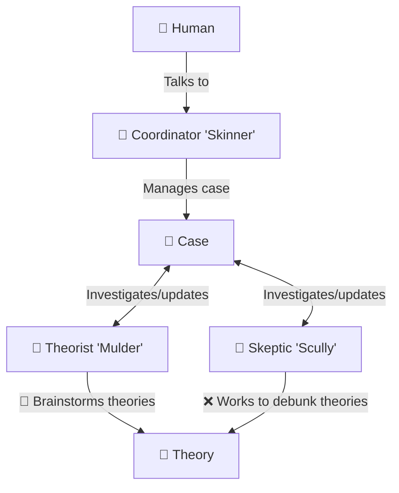

# Sleuthbots

Sleuthbots is a team of agents whose job is to investigate the unknown and debate theories until a **winning theory** is agreed upon that explains the root cause of a problem.
They are primarily intended for use in debugging/investigative situations, such as:

* Debugging code
* Investigating incidents (IcM)

It requires Python 3.10+ on Windows or Linux.

**What Sleuthbots is *not***:

Sleuthbots does *not* provide tools for investigating specific issue (such as Kusto querying tools or code debugging tools).

Sleuthbots provides a team of agents and a set of Python skills they use to coordinate their work.
The agents themselves are instructed to use other tools at their disposal, so make sure to pair Sleuthbots with other tools (MCP, local skills, other integrations, etc.) that will provide them what they need to investigate!

## The Team

* 🔎 [The Theorist](./agents/theorist.agent.md) ("**Mulder**") - Proposes theories to explain the root cause of a problem.
* 🔬 [The Skeptic](./agents/skeptic.agent.md) ("**Scully**") - Seeks to disprove the Theorist's theories with evidence.
* 💼 [The Coordinator](./agents/coordinator.agent.md) ("**Skinner**") - Directs the Theorist and the Skeptic in a loop of investigation until a **winning theory** is chosen.

(*Where did these names come from?* Check out [The X-Files](https://en.wikipedia.org/wiki/The_X-Files))

The installed agent types are `sleuthbots-theorist`, `sleuthbots-skeptic`, and `sleuthbots-coordinator`.
Use these identifiers for subagent dispatch, not the nicknames or frontmatter display names.



## Using Sleuthbots

```bash
# Run the unit tests
python3 -m unittest discover -s tests

# Install the agents and skills to your local `~/.copilot`
python3 install.py

# Install somewhere else
python3 install.py --destination "./path/to/your/custom/location"
```

Use `python3 install.py --no-overwrite` to avoid overwriting already-installed files.

Type `/agent` and select `[Sleuthbots::Coordinator] Skinner`.
Then, offer up a problem to investigate (an IcM, a bug in your code, etc.).
Skinner will dispatch the Theorist and the Skeptic to investigate.

## Agents Track Their Work

The tools provided to the sleuthbot agents allow them to create a `.sleuthbots/` working directory.
This directory is used to create **case files** and **theory files**.

* A **case** is a single mystery that is under investigation.
    * Each case can have several theories that are discussed until a **winning theory** is decided on.
* A **theory** is a single theory proposed by the Theorist and debated by the Skeptic.

A working directory used by the sleuthbots may look something like this throughout an investigation:

```
.sleuthbots/
├── cases/
│   ├── 07d5df414444e9ce/
│   │   ├── 07d5df414444e9ce.sleuth.case.md
│   │   ├── ad9a33f066453184.sleuth.theory.md
│   │   ├── cb028c01bf322ade.sleuth.theory.md
│   │   └── round-01-evidence.md
│   ├── 23aff54809e60549/
│   │   ├── 23aff54809e60549.sleuth.case.md
│   │   └── scratch
│   │       ├── 902794790-details.json
│   │       ├── 902794790-discussions.json
│   │       ├── 902794790-insights.json
│   │       ├── 902809472-details.json
│   │       ├── 902809472-discussions.json
│   │       ├── 902809472-insights.json
...
```

### Case Files

Files ending with `*.case.md` describe cases investigated by the sleuthbots.
A "case" in this scenario is a unique situation you are investigating, such as an incident or a specific software bug.
The Coordinator creates these to give other agents context behind what is investigated.
Updates on the case's investigation are posted here by the Coordinator.

A case file contains metadata (in the form of JSON) and a discussion that includes updates from the Coordinator as the investigation progresses.

<details>
<summary>(Click to Expand - Example Case File)</summary>

```markdown
---
{
  "id": "07d5df414444e9ce",
  "title": "IcM 123456789 investigation",
  "description": "Investigate root issue and determine next steps IcM 123456789.",
  "created_at": "2026-11-09T21:13:50.953120Z",
  "updated_at": "2026-11-09T21:23:53.483130Z",
  "summary": "...",
  "blocked_reason": "...",
  "round_limit": 25,
  "rounds_completed": 1
}
---

# IcM 123456789 investigation

## Overview

...

## Discussion

### 2026-11-09T21:13:57.441965Z — Skinner

Round 1 of 25: no theories selected.
Mulder will read current incident and prior analysis, consult required domain knowledge, and collect bounded distinguishing evidence.
Scully will separately assess causal claims.

...

### 2026-11-09T21:23:53.483055Z — Skinner

Round 1 of 25 completed.

...
```

</details>

### Theory Files

Files ending with `*.theory.md` describe individual theories proposed by the Theorist and debated by the Skeptic.
Both the Theorist and the Skeptic post updates to these files as their discussion proceeds.
The Coordinator will also manage these files and mark when theories are `disproved`, `accepted`, etc.

A theory file contains metadata (in the form of JSON) and a discussion that includes updates from the Theoriest and the Skeptic as they investigate and debate the theory.

<details>
<summary>(Click to Expand - Example Theory File)</summary>

```markdown
---
{
  "id": "cb028c01bf322ade",
  "title": "Recurring node-local [token-service] token acquisition failure blocks [attestation]",
  "description": "The November 8 error [error-code] on [hostname] is a continuation of the node-specific authorization-header failure documented in IcM 123456788; exact inner cause remains unverified.",
  "created_at": "2026-11-09T21:18:44.183398Z",
  "updated_at": "2026-11-09T21:23:27.170299Z",
  "case_id": "07d5df414444e9ce",
  "verdict": "unknown",
  "conclusion": ""
}
---

# Recurring node-local dSTS token acquisition failure blocks SKR

## Hypothesis

The November 8 error [error-code] on [hostname] is a continuation of the node-specific MISE authorization-header failure documented in IcM 123456788; exact inner cause remains unverified.

## Discussion

### 2026-11-09T21:20:53.500303Z — Mulder

Evidence packet: round-01-evidence.md in this case directory.
Claim remains unknown; no Scully assessment yet.

...

### 2026-11-09T21:23:27.170171Z — Scully

Assessment collection cutoff: 2026-11-09T21:23:26.940319+00:00 (UTC).
Round 1 of 25 independent skeptical assessment of the current claim.
Recommendation: UNKNOWN, not accepted and not disproven.

...

I explicitly support only the narrow identity statement: both incidents point to the exact same reported hostname, [hostname], in [clustername].
I do not agree that the complete causal claim is established.
```

</details>

## Output

When working with these agents, you can expect to see output prefixed with various emojis:

* Output prefixed with `🔎` indicates information and findings from the Theorist
* Output prefixed with `🔬` indicates information and findings from the Skeptic
* Output prefixed with `💼` indicates updates from the Coordinator

Additionally, the Coordinator will, at times, produce a **Layman's Report**.
This is a short summary describing the investigation so far, written in simple terms for easy understanding.
A Layman's Report will look something like this:

> 🤷 Layman’s Report
>
> The VM-to-host mapping is supported by the saved telemetry, but it predates the incident’s impact start by about ten minutes.
> It does not prove where the VM is running now.
> We need timestamped firmware inventory for that node to establish its BIOS version; firmware mentioned for another pool cannot substitute.
>
> 📚 Sources
>
> * [Incident Link](https://example.com)
> * File containing Kusto queries: `C:\Users\yourusername\file.md`
